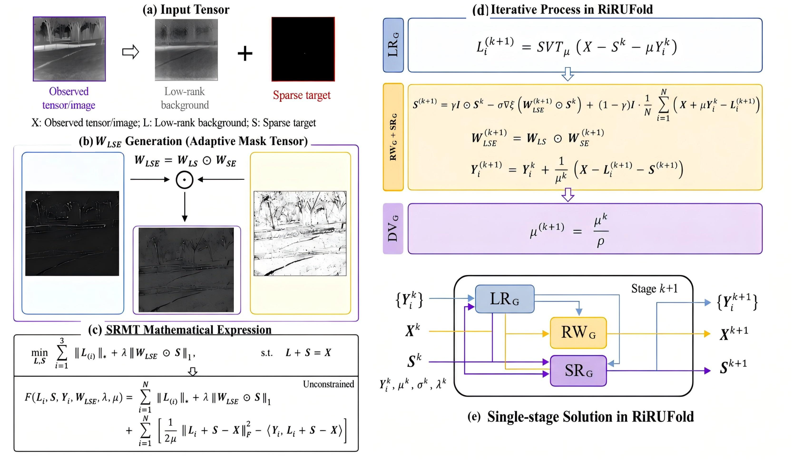
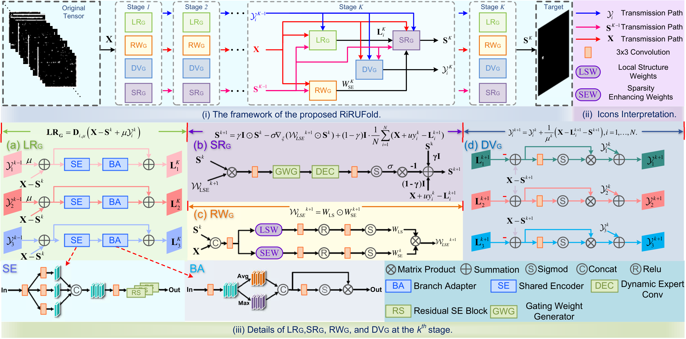

# (TGRS) RiRUFold: Rethinking Sparse Reweighted Mask Tensor Unfolding Network for Infrared Small Target Detection

🎉 **Official PyTorch implementation of "RiRUFold: Rethinking Sparse Reweighted Mask Tensor Unfolding Network for Infrared Small Target Detection", IEEE Transactions on Geoscience and Remote Sensing (TGRS).**

---

## 📄 Paper Information

<div align="center">
  
</div>
<p align="center">
  Overview of RiRUFold: Sparse Reweighted Mask Tensor (SRMT) formulation and stage-wise ADMM deep unfolding process.
</p>

<div align="center">
  
</div>
<p align="center">
  Schematic diagram of the proposed RiRUFold architecture, integrating the Low-Rank Separation Module (LR<sub>G</sub>), Sparse Target Extraction Module (SR<sub>G</sub>), Weight Generation Module (RW<sub>G</sub>), and Dual Variable Update Module (DV<sub>G</sub>).
</p>

### Abstract:
**Infrared small target detection (ISTD) remains a challenging task because small targets usually occupy only a few pixels and lack clear texture or shape information, while complex infrared backgrounds often contain strong edges, cloud clutter, and target-like interference. Existing deep unfolding methods exploit low-rank and sparse priors to provide target-background separation, but their performance is often limited by fixed low-rank and sparse assumptions and hand-crafted parameters. To address these issues, this paper proposes a Sparse Reweighted Mask Tensor Unfolding Network, termed RiRUFold, for infrared small target detection. Specifically, different from traditional low-rank and sparse decomposition methods that rely on fixed regularization weights, we design RiRUFold from the perspective of sparse reweighted mask tensor (SRMT) modeling. First, we formulate ISTD as an SRMT-constrained optimization problem, where a learnable sparse reweighted mask tensor is introduced to dynamically assign regularization. Then, we unfold this iterative optimization into a stage-wise deep network architecture, where each stage integrates four modules tailored for SRMT modeling: a low-rank separation module that efficiently estimates structured backgrounds without explicit SVD computation, a sparse target extraction module that leverages the reweighted mask to robustly extract dim small targets, a weight generation module that updates the stage-wise mask, and a dual-variable update module that feeds the decomposition residual to the next stage. Extensive experiments on public ISTD datasets demonstrate that RiRUFold outperforms representative model-driven and deep learning-based methods in terms of detection accuracy and robustness under low signal-to-noise ratios and complex backgrounds.**

---

## 🚀 Code Installation

We recommend **Python 3.10 + PyTorch + CUDA** as the software environment.

### Environment Installation
```bash
conda create -n RiRUFold python=3.10 -y
conda activate RiRUFold
pip install torch torchvision --index-url https://download.pytorch.org/whl/cu118
pip install -r requirements.txt
```

### Datasets
- **NUDT-SIRST:** [[download]](https://github.com/YeRen123455/Infrared-Small-Target-Detection) &nbsp; [[paper]](https://ieeexplore.ieee.org/abstract/document/9864119)
- **IRSTD-1K:** [[download]](https://github.com/RuiZhang97/ISNet) &nbsp; [[paper]](https://ieeexplore.ieee.org/document/9880295)
- **SIRST-Aug:** [[download]](https://github.com/Tianfang-Zhang/AGPCNet) &nbsp; [[paper]](https://ieeexplore.ieee.org/document/9412266)

* **Our project has the following structure:**
  ```text
  ├── ./asset/
  │    ├── RiRUFold_overview.png
  │    └── RiRUFold_framework.png
  ├── ./datasets/
  │    ├── NUDT-SIRST/
  │    │    ├── images/
  │    │    │    ├── 000001.png
  │    │    │    ├── ...
  │    │    ├── masks/
  │    │    │    ├── 000001.png
  │    │    │    ├── ...
  │    │    └── img_idx/
  │    │         ├── train_NUDT-SIRST.txt
  │    │         └── test_NUDT-SIRST.txt
  │    ├── IRSTD-1K/
  │    │    ├── images/
  │    │    │    ├── XDU0.png
  │    │    │    ├── ...
  │    │    ├── masks/
  │    │    │    ├── XDU0.png
  │    │    │    ├── ...
  │    │    └── img_idx/
  │    │         ├── train_IRSTD-1K.txt
  │    │         └── test_IRSTD-1K.txt
  │    └── sirst_aug/
  │         ├── trainval/
  │         │    ├── images/
  │         │    └── masks/
  │         └── test/
  │              ├── images/
  │              └── masks/
  ├── ./models/
  │    ├── __init__.py
  │    ├── RiRUFold.py
  │    └── checkpoint.py
  ├── ./utils/
  ├── train.py
  ├── evaluate.py
  └── requirements.txt
  ```

---

## ⚡ Training & Evaluation

### 1. Training
Train **RiRUFold** ($K=5$ stages, 500 epochs, Adam optimizer with `lr=1e-4` and polynomial decay) on each benchmark dataset:

```bash
# Train on NUDT-SIRST
python train.py --dataset nudt --data-root ./datasets --net-name rirufold --admm-stage-num 5 --epochs 500 --batch-size 4 --lr 1e-4 --lr-scheduler poly --base-size 256 --gpu 0 --base-dir ./results --run-name rirufold_nudt

# Train on SIRST-Aug
python train.py --dataset sirstaug --data-root ./datasets --net-name rirufold --admm-stage-num 5 --epochs 500 --batch-size 4 --lr 1e-4 --lr-scheduler poly --base-size 256 --gpu 0 --base-dir ./results --run-name rirufold_sirstaug

# Train on IRSTD-1K
python train.py --dataset irstd1k --data-root ./datasets --net-name rirufold --admm-stage-num 5 --epochs 500 --batch-size 4 --lr 1e-4 --lr-scheduler poly --base-size 256 --gpu 0 --base-dir ./results --run-name rirufold_irstd1k
```

### 2. Evaluation
Evaluate a trained checkpoint (`best.pkl`) in terms of `mIoU`, `F1`, `Pd`, and `Fa`:

```bash
# Evaluate on NUDT-SIRST
python evaluate.py --dataset nudt --data-root ./datasets --checkpoint ./results/rirufold_nudt/best.pkl --stage-num 5

# Evaluate on SIRST-Aug
python evaluate.py --dataset sirstaug --data-root ./datasets --checkpoint ./results/rirufold_sirstaug/best.pkl --stage-num 5

# Evaluate on IRSTD-1K
python evaluate.py --dataset irstd1k --data-root ./datasets --checkpoint ./results/rirufold_irstd1k/best.pkl --stage-num 5
```

---

## 📊 Citation

If you find this repository helpful in your research, please consider citing our paper:

```bibtex
@ARTICLE{RiRUFold,
  author={Xu, Guoxia and Zhang, Yao and Chen, Kang and Deng, Lizhen and Zhu, Hu},
  journal={IEEE Transactions on Geoscience and Remote Sensing},
  title={RiRUFold: Rethinking Sparse Reweighted Mask Tensor Unfolding Network for Infrared Small Target Detection},
  year={2026}
}
```

---

Please ⭐ **Star** this repository to receive the latest update notifications!
